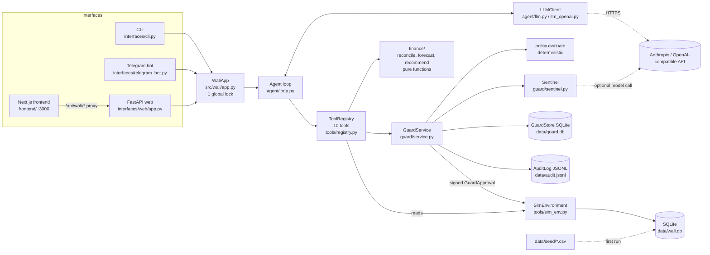
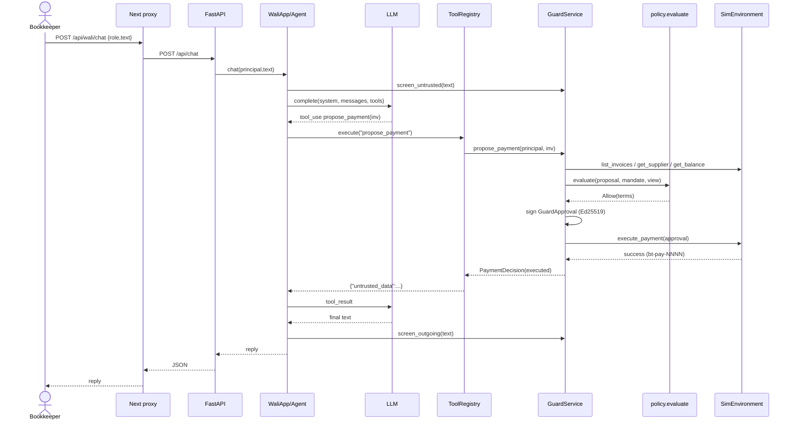
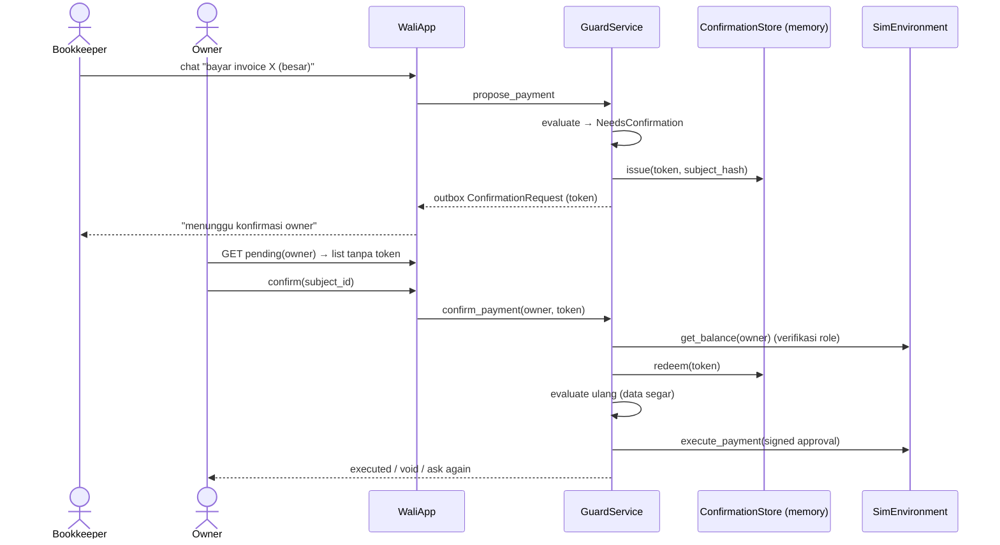

# PROJECT_AUDIT.md — Serah Terima Project "Wali"

> Tanggal audit: 2026-10-15. Mode audit: read-only. Satu-satunya file yang dibuat adalah dokumen ini.
> Label yang dipakai:
> - **[FAKTA]**: terlihat langsung di kode atau file.
> - **[ASUMSI]**: kesimpulan dari petunjuk tidak langsung.
> - **[TIDAK DIKETAHUI]**: tidak bisa dipastikan dari kode, jadi perlu ditanyakan.
>
> Batasan audit:
> - Tes Python **tidak dijalankan**: `.venv` belum ada dan `uv` tidak ada di PATH mesin ini.
> - Frontend **tidak di-build**: `frontend/node_modules` belum ada.
> - Isi `.env` asli tidak dibuka. File itu memang tidak ada di checkout ini.

---

# 1. Ringkasan Eksekutif

- **Apa ini:** **Wali** adalah asisten keuangan berbasis chat (AI agent) untuk usaha kecil. Project ini dibuat untuk FinTechathon 2026, International AI Track, direction E (`README.md:1-5`).
  - Wali bisa melakukan rekonsiliasi bank vs pembukuan, membuat forecast arus kas, memberi rekomendasi, dan **mengusulkan pembayaran invoice supplier**.
  - Setiap pembayaran dijaga oleh "guard" deterministik yang memakai mandat bertanda tangan Ed25519.
- **Semuanya simulasi.** Tidak ada bank sungguhan, uang sungguhan, atau data pribadi asli (`README.md:7-8`) [FAKTA].
- **Untuk siapa:** pemilik usaha (owner), bookkeeper, dan staff dari satu bisnis sintetis bernama "Toko Sari" (`data/seed/users.csv`, `data/seed/business.csv`).
- **Stack:**
  - Backend Python 3.11: FastAPI, Pydantic v2, SQLite, `cryptography` (Ed25519), Anthropic SDK atau endpoint OpenAI-compatible, `python-telegram-bot` (`pyproject.toml`).
  - Frontend Next.js 16 dan React 19 sebagai proxy UI (`frontend/package.json`).
  - Tiga antarmuka: CLI, bot Telegram, dan web.
- **Kematangan:** prototipe hackathon dengan kualitas kode yang tinggi.
  - Arsitekturnya rapi dan setiap keputusan didokumentasikan (`docs/assumptions.md`, 95 butir C1–C95).
  - Ada 27 file tes dan suite evaluasi (tasks, dialogues, attacks, sentinel).
  - Fase 9–10 (hardening dan packaging) **belum dimulai** (`README.md:27`).
  - Tidak ada CI, Docker, atau autentikasi.
- **3 hal terpenting:**
  1. **Keamanan uang tidak bergantung pada LLM.** Semua keputusan bayar ada di `src/wali/guard/policy.py` dan `src/wali/guard/service.py`. Model hanya bisa *mengusulkan* lewat 10 tool tetap (`src/wali/tools/registry.py:1-13`). Jangan pernah memindahkan logika keputusan ke prompt.
  2. **Tidak ada login.** Role dipilih bebas di web (`src/wali/interfaces/web/app.py:5-7`, `frontend/README.md:25`). Server ini **tidak boleh** diekspos ke jaringan publik.
  3. **Kondisi git lokal tidak normal.** Branch `update` berisi *orphan commit* (`bbadcd3`) yang hanya memuat gitlink `wali-agent` tanpa `.gitmodules`. Semua 174 file kode masih berstatus *staged, belum di-commit*. Rapikan ini sebelum mulai bekerja (lihat §12 dan §13).

---

# 2. Tujuan dan Konteks Produk

**Masalah yang diselesaikan** [FAKTA, `README.md:1-8`, `docs/assumptions.md`]: pemilik usaha kecil butuh bantuan untuk:
- mencocokkan mutasi bank dengan buku;
- melihat apakah kas akan kurang dalam 30 hari ke depan;
- membayar supplier dengan aman, termasuk menghadapi invoice palsu, perubahan rekening, invoice ganda, dan prompt injection.

Inti "nilai jual"-nya adalah **agent AI yang ikut bertransaksi tetapi tidak bisa disalahgunakan** ("AI as a Financial Participant").

**Peran (roles)** [FAKTA, `src/wali/models.py:16`, `src/wali/tools/sim_env.py:5-10`, `src/wali/guard/mandate.py:6-10`]:

| Role | Hak |
| --- | --- |
| `owner` | Melihat semua data, membuat dan mengonfirmasi mandat, mengonfirmasi pembayaran. Hanya owner yang bisa confirm. |
| `bookkeeper` | Melihat saldo, mutasi, invoice, supplier, dan buku. Boleh mengusulkan pembayaran jika mandat mengizinkan. Boleh mencatat entri buku. |
| `staff` | Hanya entri buku kategori `sales` dan invoice receivable. **Tidak pernah** boleh mengusulkan pembayaran. |

**Fitur utama** [FAKTA, 10 tool di `src/wali/tools/registry.py:76-225`]:
- **Baca data:** `get_balance`, `list_transactions`, `list_invoices`, `get_supplier`.
- **Analisis:**
  - `reconcile_period` (`src/wali/finance/reconcile.py:135`)
  - `forecast_cashflow` (`src/wali/finance/forecast.py:52`), yang juga menghasilkan rekomendasi dari `src/wali/finance/recommend.py:55`
- **Aksi:** `record_book_entry`, `flag_for_review`, `propose_payment`, `propose_mandate`.
- **Guard:**
  - mandat bertanda tangan
  - kebijakan 11 aturan (`src/wali/guard/policy.py:7-23`)
  - token konfirmasi sekali pakai
  - audit log hash-chain
- **Sentinel:** screening teks dari luar (invoice, memo bank, pesan user) dan pemeriksaan balasan keluar (`src/wali/guard/sentinel.py:1-23`).
- **Antarmuka:**
  - CLI (`src/wali/interfaces/cli.py`)
  - Telegram (`src/wali/interfaces/telegram_bot.py`)
  - web statis lama (`src/wali/interfaces/web/static/`)
  - web baru Next.js (`frontend/`)
- **Evaluasi:** `eval/`, dengan 10 task, 11 dialog, 20 serangan, dan 46 sentinel seed.

**Fitur setengah jadi atau tidak terpakai:**

| Item | Bukti | Status |
| --- | --- | --- |
| Adapter environment panitia (organiser) | `src/wali/tools/organiser_env.py:32` raises `NotImplementedError`; `src/wali/app.py:297-301` | [FAKTA] Slot kosong. API panitia tidak diketahui (U1 di `docs/assumptions.md:10`). |
| Hardening dan packaging (fase 9–10) | `README.md:27` | [FAKTA] Belum dimulai. |
| Format submission | `docs/assumptions.md:12` (U3) | [FAKTA] Belum ditangani. |
| `MANUAL_MINUTES_PER_ITEM` | `src/wali/config.py:136-137` | [FAKTA] Masih placeholder (nilai 5 menit). |
| Staff melihat penjualan lewat chat | `docs/assumptions.md:80` (C52) | [FAKTA] Tidak ada tool untuk itu. |
| Tombol UI feedback, regenerate, attach, mic | `frontend/components/ui/ai-assistant-interface.tsx:29-50` (`FutureControl`) | [FAKTA] Dinonaktifkan. |
| Halaman mandat hanya bisa membuat *mandat demo* tetap | `frontend/components/mandate-page.tsx:111-123`, `src/wali/interfaces/common.py:13-22` | [FAKTA] Isi mandat tidak bisa diedit dari UI. |
| Web statis lama (`src/wali/interfaces/web/static/`) | `DESIGN.md:3` | [ASUMSI] Digantikan oleh `frontend/`, tetapi masih disajikan FastAPI di `/`. |
| CSS lama dan dependensi tak terpakai di frontend | `frontend/app/globals.css` (sekitar 70 selector tidak dipakai), `frontend/lib/utils.ts` (`cn()` tidak diimpor), `@fontsource/outfit` | [FAKTA] Kode mati. |

---

# 3. Tech Stack dan Dependensi

**Backend Python** (pin persis di `pyproject.toml:7-22`, terkunci di `uv.lock`):

| Komponen | Versi | Fungsi | Catatan |
| --- | --- | --- | --- |
| Python | 3.11 (`.python-version`, `requires-python >=3.11,<3.12`) | Bahasa | Dibatasi hanya 3.11. |
| uv | — | Package manager | Wajib (`README.md:31-34`). |
| `anthropic` | 1.13.0 | SDK model default | Memakai beta `server-side-fallback-2026-07-01` (`src/wali/agent/llm.py:23`). [TIDAK DIKETAHUI] apakah beta ini tersedia untuk akun Anda. C44 menyebut fitur ini belum diverifikasi live. |
| `httpx` | 0.28.1 | Client HTTP untuk provider OpenAI-compatible | `src/wali/agent/llm_openai.py:143` |
| `fastapi` | 0.143.0 | API web | `src/wali/interfaces/web/app.py` |
| `uvicorn` | 0.54.0 | Server ASGI | |
| `pydantic` | 2.14.1 | Model data dan validasi | Semua model `frozen`, `extra="forbid"` (`src/wali/models.py:28-29`) |
| `cryptography` | 50.0.2 | Tanda tangan Ed25519 | `src/wali/guard/signing.py`, `src/wali/guard/keys.py` |
| `python-telegram-bot` | 22.8 | Bot Telegram | |
| `pyyaml` | 6.0.3 | Membaca YAML eval | |
| `pytest` (dev) | 9.1.1 | Tes | |
| `ruff` (dev) | 0.17.0 | Lint dan format | |
| Database | SQLite (stdlib) | `data/wali.db` (simulasi bank) dan `data/guard.db` (guard) | Tanpa ORM. SQL ditulis langsung dan ter-parameterisasi. |

**Frontend** (`frontend/package.json`; versi hasil resolve diambil dari `frontend/package-lock.json`):

| Komponen | Versi | Fungsi | Catatan |
| --- | --- | --- | --- |
| `next` | ^16.4.0 (resolve 16.4.0) | Framework UI dan route proxy | Butuh Node >= 20.9. `frontend/AGENTS.md` memperingatkan bahwa API Next 16 berbeda dari versi lama. |
| `react`, `react-dom` | ^19.3.0 | UI | |
| `motion` | ^14.2.0 | Animasi | |
| `@paper-design/shaders-react` | 0.0.81 | Background WebGL | **Versi 0.0.x (pra-1.0)** sehingga API bisa berubah. Risiko sedang. |
| `lottie-web` | 5.13.0 | Animasi logo | |
| `@fontsource/poppins` | 5.3.0 | Font | |
| `@fontsource/outfit`, `clsx`, `tailwind-merge` | — | **Tidak dipakai** | Kode mati. |
| `typescript` | ^6.0.3 | Type check | Major baru. |
| `tailwindcss` | ^4.3.3 | CSS | Hampir tidak dipakai. |
| `playwright` | 1.62.1 | Skrip verifikasi UI | Butuh Google Chrome terpasang. |

**Layanan eksternal:**
- API Anthropic, atau endpoint OpenAI-compatible yang dipilih lewat `WALI_LLM_PROVIDER`.
- Telegram Bot API, yang dipakai lewat long polling (`src/wali/interfaces/telegram_bot.py:485`).

**Risiko keamanan dependensi:** [TIDAK DIKETAHUI]. Audit ini tidak menjalankan `pip-audit` atau `npm audit` karena tidak ada environment terpasang dan tidak boleh mengakses jaringan.
- Sisi positifnya: semua dependensi Python di-pin persis.
- Frontend memakai rentang caret (`^`), jadi gunakan `npm ci` agar sesuai lockfile.
- **Saran:** jalankan `uv run pip-audit` (perlu ditambahkan dulu) dan `npm audit` di minggu pertama.

---

# 4. Arsitektur

## 4.1 Gambaran komponen



[FAKTA] Wiring diatur oleh `build_app` di `src/wali/app.py:279-353`.

## 4.2 Pola arsitektur dan alasannya

- **Ports and Adapters (protocol interface).** Semua akses data lewat `FinancialEnvironment` (`src/wali/tools/base.py:38-62`). Implementasinya `SimEnvironment` dan `OrganiserEnvironment` (kosong).
  - Alasan [FAKTA, `docs/assumptions.md:10` U1]: API environment panitia belum diketahui, jadi adapternya harus bisa ditukar.
- **Policy sebagai pure function plus service pemegang kunci.** `evaluate()` tidak membaca clock, DB, atau kunci privat (`src/wali/guard/policy.py:1-6`), sedangkan `GuardService` memegang kunci dan state.
  - Alasan: keputusan pembayaran bisa dites deterministik dan tidak bisa dipengaruhi model.
- **Capability-based tools.** Registry dibuat per principal, dan tool tidak menerima parameter user, role, atau business (`src/wali/tools/registry.py:3-5`). Model tidak bisa "menjadi owner".
- **Defense in depth.**
  - Environment memverifikasi ulang role dari tabel users (`src/wali/tools/sim_env.py:304-317`).
  - Environment memverifikasi ulang tanda tangan approval (`src/wali/tools/sim_env.py:441-515`).
  - Guard menjalankan ulang seluruh policy saat konfirmasi (`src/wali/guard/service.py:963-1024`).
- **Hand-written agent loop** tanpa framework agen (`src/wali/agent/loop.py`), sehingga kontrol atas history dan screening penuh.
- **Pembangunan bertahap per fase** (Phase 0–8 di riwayat git).

## 4.3 Struktur folder

| Path | Tanggung jawab |
| --- | --- |
| `src/wali/models.py` | Semua model Pydantic: uang (`Decimal`), invoice, supplier, approval. |
| `src/wali/config.py` | Membaca env dan `.env` secara fail-closed. Pemetaan env→field ada di `:23-58`. |
| `src/wali/app.py` | `WaliApp` (chat dan inbox konfirmasi) serta `build_app` (wiring). |
| `src/wali/agent/` | `loop.py` (loop tool-use), `llm.py` dan `llm_openai.py` (wrapper model), `prompts.py` (system prompt), `dialogue.py` (helper deterministik: periode, koreksi, cek angka). |
| `src/wali/tools/` | `base.py` (protocol dan exception), `registry.py` (10 tool), `sim_env.py` (bank simulasi SQLite), `organiser_env.py` (slot kosong). |
| `src/wali/finance/` | Logika keuangan murni: rekonsiliasi, forecast, rekomendasi. |
| `src/wali/guard/` | `service.py` (pintu tunggal), `policy.py`, `mandate.py`, `confirm.py` (token), `signing.py`, `keys.py`, `store.py` (SQLite guard), `audit.py` (hash chain), `sentinel.py`. |
| `src/wali/interfaces/` | CLI, Telegram, web FastAPI dan halaman statisnya, `common.py` (mandat demo, format request). |
| `frontend/` | UI Next.js "Paper": halaman `/chat`, `/approvals`, `/mandate`, dan proxy `app/api/wali/[action]/route.ts`. |
| `eval/` | Harness evaluasi dengan model sungguhan, dan laporan JSON/MD di `eval/reports/`. |
| `tests/` | 27 file pytest dengan LLM palsu (`tests/conftest.py:126` `ScriptedLLM`). |
| `scripts/` | `gen_guard_key.py`, `gen_seed_data.py` (deterministik, seed 42), `live_check.py` (memanggil model sungguhan). |
| `data/seed/` | CSV sintetis dan `ground_truth.json` untuk evaluasi. |
| `docs/assumptions.md` | **Dokumen keputusan desain terpenting** (U1–U6, D1–D3, C1–C95). |
| `anti-slop/` | 16 catatan audit UI frontend tertanggal 2026-10-15. |
| `wali-agent/` | Repo git bersarang (clone lama, fase 0) yang tercatat sebagai gitlink. Lihat §9. |

## 4.4 Entry point, routing, dan alur request

**Entry point** [FAKTA, `Makefile`]:
- `python -m wali.interfaces.cli --role owner` (`src/wali/interfaces/cli.py:145`)
- `python -m wali.interfaces.telegram_bot` (`src/wali/interfaces/telegram_bot.py:452`)
- `python -m wali.interfaces.web` (`src/wali/interfaces/web/__main__.py`, lalu `src/wali/interfaces/web/app.py:148`). Default host 127.0.0.1:8000.
- `cd frontend && npm run dev` (127.0.0.1:3000)
- `python -m eval.run_eval --suite all`

**Route FastAPI** (`src/wali/interfaces/web/app.py:86-141`):

| Method | Path | Fungsi |
| --- | --- | --- |
| GET | `/` | Halaman statis lama |
| GET | `/api/info` | Daftar role dan status sentinel model |
| POST | `/api/chat` | `{role, text}`, lalu `WaliApp.chat` |
| GET | `/api/pending?role=` | Request konfirmasi untuk role tersebut |
| POST | `/api/confirm`, `/api/cancel` | `{role, subject_id}` |
| POST | `/api/mandate` | Draft mandat demo (owner) |
| POST | `/api/reset` | Hapus sesi chat |

**Middleware** (`src/wali/interfaces/web/app.py:72-84`): request non-GET wajib JSON dan Origin harus sama (atau tidak ada Origin). Setelah itu ditambahkan header keamanan (CSP dan lain-lain).

**Proxy Next.js** (`frontend/app/api/wali/[action]/route.ts`):
- Allowlist action ada di `:3-4`.
- Cek Origin dan content-type ada di `:25-36`.
- Request diteruskan ke `WALI_API_ORIGIN` tanpa header Origin (`:46-55`).

**Alur request umum:**

```
Browser → Next /api/wali/chat → FastAPI /api/chat → WaliApp.chat (lock)
        → Agent.respond → LLM ↔ ToolRegistry → GuardService / SimEnvironment → reply → OutgoingScreen → JSON
```

## 4.5 Model data

Ada dua database SQLite dan satu file log.

**`data/wali.db`** berisi simulasi bank (skema di `src/wali/tools/sim_env.py:63-96`). **`data/guard.db`** berisi catatan guard (skema di `src/wali/guard/store.py:24-44`). Uang disimpan sebagai `TEXT` agar presisi `Decimal` terjaga.

```mermaid
erDiagram
  business ||--o{ users : "business_id"
  suppliers ||--o{ invoices : "counterparty_id (payable)"
  invoices ||--o| payments : "invoice_id UNIQUE"
  invoices ||--o{ book_entries : "invoice_id (opsional)"
  payments ||--|| bank_transactions : "transaction_id (bt-pay-NNNN)"
  business { TEXT id PK; TEXT name; TEXT currency; TEXT opening_balance; TEXT opening_date; TEXT as_of_date }
  users { TEXT id PK; TEXT name; TEXT role; TEXT business_id }
  suppliers { TEXT id PK; TEXT name; TEXT verified_account; INT account_verified; TEXT avg_invoice_amount }
  invoices { TEXT id PK; TEXT kind; TEXT counterparty_id; TEXT number; TEXT amount; TEXT status; INT late_fee_bearing; TEXT stated_account; TEXT document_text }
  bank_transactions { TEXT id PK; TEXT date; TEXT amount; TEXT direction; TEXT counterparty; TEXT memo; TEXT reference }
  book_entries { TEXT id PK; TEXT date; TEXT amount; TEXT direction; TEXT category; TEXT invoice_id; INT reconciled; TEXT created_by }
  payments { TEXT approval_id PK; TEXT invoice_id UK; TEXT supplier_id; TEXT amount; TEXT destination_account; TEXT transaction_id; TEXT executed_at }
```

Catatan model data:
- [FAKTA] Tidak ada `FOREIGN KEY` yang dideklarasikan. Relasi di atas hanya logis, dan konsistensinya dijaga oleh kode.
- **guard.db** berisi tabel `mandates`, `executions` (invoice_id UNIQUE, untuk mencegah bayar ganda), `proposal_events` (rate limit), `review_items`, dan `counters`.
- **State in-memory yang hilang saat restart** [FAKTA, `src/wali/guard/store.py:8-9`, `src/wali/guard/service.py:300-302`]:
  - proposal yang menunggu konfirmasi
  - draft mandat
  - token konfirmasi
  - sesi chat (`src/wali/app.py:74-75`)
- **Audit log** (`data/audit.jsonl`) memakai format JSONL dengan `hash = sha256(prev_hash + canonical_json(entry))` (`src/wali/guard/audit.py:1-11`).
- **Model domain:** `Principal`, `Invoice`, `Supplier`, `GuardApproval` (ditandatangani, termasuk `destination_account`), dan `Mandate` (`src/wali/guard/mandate.py:53-111`).
- **Data seed:**

  | Data | Jumlah |
  | --- | --- |
  | Transaksi bank | 224 |
  | Entri buku | 221 |
  | Invoice | 95 (85 payable, 10 receivable) |
  | Supplier | 10 (`sup-mesin` belum terverifikasi) |
  | User | 3 |

  Seed sengaja berisi kasus jebakan, misalnya invoice `inv-0094` yang memuat instruksi tersembunyi dan perubahan rekening (`data/seed/invoices.csv:95`, `scripts/gen_seed_data.py:629-636`).

## 4.6 Integrasi eksternal

| Integrasi | File | Catatan |
| --- | --- | --- |
| Anthropic Messages API | `src/wali/agent/llm.py:64-164` | Tanpa temperature (C41). Opsional `output_config.effort`. Beta refusal fallback. |
| Endpoint OpenAI-compatible | `src/wali/agent/llm_openai.py:110-272` | Retry 0.5s dan 1.5s (`:30`, `:150-217`). |
| Sentinel model (opsional) | `src/wali/guard/sentinel.py:551-690` | Panggilan model terpisah tanpa tool. `max_tokens` dibatasi 4000 (`src/wali/app.py:276`). |
| Telegram Bot API | `src/wali/interfaces/telegram_bot.py:441-489` | Polling. Hanya private chat (`:446`). |
| Payment, email, storage cloud, queue | — | [FAKTA] Tidak ada. Pembayaran hanya simulasi di SQLite. |

---

# 5. Alur Kerja Utama (Walkthrough)

## 5.1 Chat → pembayaran kecil yang langsung dieksekusi

Konteks: bookkeeper atau owner menulis "bayar invoice kopi" dan nilainya di bawah `confirm_above`.

1. **UI.** Pesan dikirim dari `frontend/components/ui/ai-assistant-interface.tsx` lewat `sendMessage` di `frontend/components/workspace-provider.tsx:177-227`, lalu `waliPost("chat", {role, text})` (`frontend/lib/wali-api.ts:48-57`).
2. **Proxy.** `frontend/app/api/wali/[action]/route.ts:21-44` meneruskan request ke FastAPI.
3. **FastAPI.** `src/wali/interfaces/web/app.py:98-105` memetakan role ke `Principal` dari `wali.env.principals()` (`src/wali/tools/sim_env.py:535`).
4. **WaliApp.chat** (`src/wali/app.py:112-144`):
   - mengambil lock;
   - mengambil atau membuat `Session` dengan system prompt sesuai role (`src/wali/app.py:97-110`);
   - men-screen pesan user (`screen_untrusted`, `src/wali/app.py:124-130`);
   - membuat `ToolRegistry` khusus principal ini (`src/wali/app.py:131-142`).
5. **Agent loop** (`src/wali/agent/loop.py:157-252`) memanggil model dengan 10 skema tool. Model memanggil `list_invoices`, lalu `propose_payment`.
6. **Registry** (`src/wali/tools/registry.py:389-428`, `:708-737`) memvalidasi argumen dengan Pydantic, lalu memanggil `GuardService.propose_payment`.
7. **Guard** (`src/wali/guard/service.py:544-602`):
   - mencatat proposal (untuk rate limit) dan audit;
   - `_decide` menjalankan `check_authority`;
   - `_build_view` membaca invoice, supplier, dan saldo, lalu men-screen teks invoice dan supplier;
   - menjalankan `policy.evaluate` (`src/wali/guard/policy.py:387`).
8. **Jika hasilnya `Allow`:** `_execute` (`src/wali/guard/service.py:806-938`) membuat `GuardApproval`, menandatanganinya dengan Ed25519 (berlaku 60 detik), lalu memanggil `SimEnvironment.execute_payment`.
9. **Environment** (`src/wali/tools/sim_env.py:441-515`):
   - verifikasi tanda tangan, kedaluwarsa, sekali pakai, kecocokan invoice, rekening terverifikasi, dan saldo cukup;
   - INSERT ke `bank_transactions` dan `payments`, lalu UPDATE status invoice menjadi `paid`, semuanya dalam satu transaksi.
10. **Setelah bayar**, guard mencatat ke `executions`, audit `payment_executed`, dan entri buku `supplier_payment` jika mandat mengizinkan.
11. **Hasil** dikembalikan ke model sebagai JSON `{"untrusted_data": ...}`.
12. **Pemeriksaan balasan:** model menulis jawaban, `reply_problems` mengecek angka dan bahasa (`src/wali/agent/dialogue.py:313`), lalu `OutgoingScreen` menyaring rahasia (`src/wali/guard/sentinel.py:753`).
13. **Respons** dikirim sebagai JSON ke UI, yang menampilkannya sebagai teks biasa.



## 5.2 Pembayaran besar → konfirmasi owner

1. Langkah 1–7 sama dengan §5.1, tetapi `evaluate` mengembalikan `NeedsConfirmation`. Penyebabnya bisa nilai di atas `confirm_above`, saldo turun di bawah buffer, nilai lebih dari 30% di atas rata-rata supplier, atau ada kecurigaan injection.
2. `_request_confirmation` (`src/wali/guard/service.py:735-804`):
   - membatalkan proposal lama untuk invoice yang sama;
   - menerbitkan token (`src/wali/guard/confirm.py:69-91`, `secrets.token_urlsafe(32)`, yang disimpan hanya hash-nya);
   - menaruh `ConfirmationRequest` di `_outbox`.
3. `WaliApp._collect` memindahkan outbox ke inbox (`src/wali/app.py:153-156`). **Token tidak pernah sampai ke model.** Web hanya mengirim `request_view` tanpa token (`src/wali/interfaces/common.py:59-61`).
4. Owner membuka `/approvals`. `frontend/components/approvals-page.tsx` mengambil data dari `GET /api/pending?role=owner` (`src/wali/interfaces/web/app.py:107-109`, lalu `src/wali/app.py:158-176`).
5. Owner menekan Confirm. `decide()` (`frontend/components/workspace-provider.tsx:275-294`) mengirim `POST /api/confirm {role, subject_id}`, lalu `WaliApp.confirm` (`src/wali/app.py:190-216`) memanggil `GuardService.confirm_payment`.
6. `_confirm` (`src/wali/guard/service.py:963-1024`):
   - memastikan principal benar-benar owner di tabel users (`_owner_problem`, `:345-360`);
   - menebus token;
   - **menjalankan ulang policy dengan data terbaru**. Jika syarat (terms) berubah, konfirmasi batal (VOID). Jika muncul peringatan baru, owner diminta konfirmasi ulang.
   - Jika lolos, `_execute` dijalankan seperti §5.1 langkah 8–10.



## 5.3 Membuat mandat (prasyarat semua pembayaran)

Tanpa mandat aktif, semua pembayaran ditolak dengan alasan `MANDATE_INVALID` (`src/wali/guard/policy.py:9`).

1. Owner menekan "Draft mandate" di `/mandate` (`frontend/components/mandate-page.tsx:111-123`), atau mengetik `/mandate` di CLI atau Telegram.
2. `POST /api/mandate` (`src/wali/interfaces/web/app.py:124-134`) memanggil `draft_demo_mandate` (`src/wali/interfaces/common.py:31-35`). Mandat ini memakai nilai tetap dari `DEMO_MANDATE` (`:13-22`) dan mencakup semua supplier terverifikasi.
3. `GuardService.draft_mandate` (`src/wali/guard/service.py:1073`, `:1092-1222`):
   - memastikan principal adalah owner;
   - memastikan setiap supplier ada dan terverifikasi;
   - membuat `MandateTerms` (yang divalidasi `src/wali/guard/mandate.py:69-96`);
   - menerbitkan token konfirmasi.
4. Owner mengonfirmasi di `/approvals`. `_confirm_mandate` (`src/wali/guard/service.py:1237-1283`) menandatangani mandat, menyimpannya di tabel `mandates` (`src/wali/guard/store.py:88`), lalu mencatat audit `mandate_activated`.
5. Setiap kali dipakai, mandat diverifikasi ulang: tanda tangan, bisnis, dan masa berlaku (`src/wali/guard/mandate.py:119-134`).

Model juga bisa memanggil tool `propose_mandate` dengan parameter bebas (`src/wali/tools/registry.py:739-742`), tetapi tetap butuh tombol konfirmasi owner.

## 5.4 Rekonsiliasi periode

1. User menulis "rekonsiliasi September". Tanggal periode sudah dihitung oleh kode dan dimasukkan ke prompt (`src/wali/agent/dialogue.py:27-77`, C53).
2. Tool `reconcile_period` (`src/wali/tools/registry.py:561-625`) membaca mutasi dan buku lewat `_read`. Pembacaan ini diulang sekali jika gagal, lalu hasilnya di-screen sentinel (`:479-494`).
3. `reconcile()` (`src/wali/finance/reconcile.py:135`) mencocokkan data dalam 5 tahap (`:1-13`) dan menghasilkan `ReconciliationReport`.
4. Model merangkum hasilnya. Angka yang tidak berasal dari data tool memicu koreksi otomatis sekali (`src/wali/agent/loop.py:226-249`).

---

# 6. Konfigurasi dan Environment

Sumber: `.env.example` dan pemetaan di `src/wali/config.py:23-58`.

Cara memuat:
- Variabel environment proses menimpa nilai dari `.env` (`src/wali/config.py:170-173`).
- Nilai kosong dianggap tidak di-set.
- Nilai yang tidak valid menghasilkan `ConfigError` tanpa mencetak nilainya (`src/wali/config.py:180-187`).

| Variabel | Fungsi | Default di kode |
| --- | --- | --- |
| `WALI_LLM_PROVIDER` | `anthropic` atau `openai_compatible` | `anthropic` |
| `ANTHROPIC_API_KEY` | **Secret.** Kunci Anthropic | — |
| `WALI_LLM_API_KEY` | **Secret.** Kunci provider OpenAI-compatible | — |
| `WALI_AGENT_MODEL` | Nama model agen (wajib, tanpa default, C5) | — |
| `WALI_SENTINEL_MODEL` | Model screening. Kosong berarti hanya rules. | — |
| `WALI_LLM_BASE_URL` | Base URL endpoint | — |
| `WALI_LLM_MAX_TOKENS` | Batas token output | 16000 |
| `WALI_LLM_TEMPERATURE` | Hanya untuk openai_compatible | — |
| `WALI_LLM_EFFORT` | low sampai max (Anthropic) | — |
| `WALI_LLM_REFUSAL_FALLBACK` | Beta fallback | Otomatis |
| `WALI_LLM_TIMEOUT_SECONDS` | Timeout model | 120 |
| `WALI_GUARD_PRIVATE_KEY` | **Secret.** Kunci privat Ed25519 guard | — (wajib) |
| `WALI_GUARD_PUBLIC_KEY` | Kunci publik. Pada praktiknya diturunkan dari kunci privat (`src/wali/app.py:295`). | — |
| `WALI_ENVIRONMENT` | `sim` atau `organiser` (yang kedua belum diimplementasi) | `sim` |
| `WALI_SIM_TODAY` | Tanggal "hari ini" simulasi | Hari setelah seed berakhir (2026-10-01) |
| `WALI_DB_PATH`, `WALI_GUARD_DB_PATH`, `WALI_SEED_DIR`, `WALI_AUDIT_LOG_PATH` | Lokasi penyimpanan | `data/...` |
| `WALI_DEFAULT_CURRENCY`, `WALI_UTC_OFFSET_HOURS` | Locale | IDR, +7 |
| `SIM_FAIL_RATE`, `SIM_SEED` | Injeksi kegagalan simulasi | 0, 42 |
| `WALI_RECON_DATE_WINDOW_DAYS`, `WALI_RECON_AMOUNT_TOLERANCE`, `WALI_RECON_MISMATCH_MAX_RATIO` | Toleransi rekonsiliasi | 3, 0, 0.05 |
| `WALI_AGENT_MAX_STEPS` | Batas panggilan model per pesan | 8 |
| `WALI_HISTORY_MAX_TURNS` | Panjang history chat | 30 |
| `WALI_CONFIRM_TOKEN_TTL_SECONDS` | Masa berlaku token konfirmasi | 300 |
| `WALI_PROPOSALS_PER_HOUR` | Rate limit proposal | 10 |
| `WALI_SENTINEL_STRICT_TURN` | Satu temuan membuat semua pembayaran di turn itu menunggu owner | false |
| `WALI_TELEGRAM_BOT_TOKEN` | **Secret.** Token BotFather | — |
| `WALI_TELEGRAM_USERS` | Pemetaan `tgid=user-id[\|user-id]` | — |
| `MANUAL_MINUTES_PER_ITEM` | Placeholder metrik eval | 5 |
| `WALI_API_ORIGIN` (frontend, `frontend/.env.example`) | Alamat FastAPI untuk proxy | `http://127.0.0.1:8000` (`frontend/app/api/wali/[action]/route.ts:5`) |

**Perbedaan dev, staging, dan production:** [FAKTA] Tidak ada konsep environment selain `WALI_ENVIRONMENT=sim|organiser`. [TIDAK DIKETAHUI] Tidak ada staging atau production yang terdokumentasi. Project ini hanya berjalan lokal.

**Feature flag** (dikendalikan lewat env):
- `WALI_SENTINEL_MODEL` (aktif jika di-set)
- `WALI_SENTINEL_STRICT_TURN`
- `WALI_LLM_REFUSAL_FALLBACK`
- `SIM_FAIL_RATE`

**File konfigurasi penting:**
- `pyproject.toml` (dependensi, pytest, ruff)
- `Makefile`
- `.gitignore` (mengabaikan `.env`, `*.db`, `data/audit*.jsonl`, `eval/reports/*`, dan `.claude/`)
- `.gitattributes` (memaksa LF supaya hash seed stabil)
- `frontend/next.config.ts` (`allowedDevOrigins` berisi IP LAN `192.168.0.13` yang di-hardcode)
- `frontend/tsconfig.json`
- `frontend/eslint.config.mjs`

---

# 7. Cara Menjalankan, Tes, Build, dan Deploy

## 7.1 Backend (berdasarkan `README.md:29-63` dan `Makefile`)

```bash
# prasyarat: Python 3.11 + uv
uv sync
cp .env.example .env
uv run python scripts/gen_guard_key.py --write-env   # menulis kunci privat ke .env
# isi WALI_AGENT_MODEL + API key di .env
uv run python scripts/live_check.py --quick          # MEMAKAI kredit model
uv run python -m wali.interfaces.cli --role owner    # CLI
uv run python -m wali.interfaces.web                 # http://127.0.0.1:8000
```

Catatan:
- Run pertama membangun `data/wali.db` dari `data/seed/` (`src/wali/app.py:303-313`).
- Reset state dengan menghapus `data/wali.db`, `data/guard.db`, dan `data/audit.jsonl` (`README.md:126`).

## 7.2 Frontend (`frontend/README.md:8-30`)

```bash
cd frontend
npm ci
npm run dev        # http://127.0.0.1:3000 → redirect /chat
```

FastAPI harus berjalan di port 8000.
- `frontend/README.md` memakai **path Windows/PowerShell** (`D:\Program Files\nodejs\npm.cmd`, `.uv-cache-v2`).
- Dokumen itu juga menyebut "`.venv` yang rusak".
- [ASUMSI] Pengembang sebelumnya bekerja di Windows. Di WSL atau Linux, gunakan perintah biasa seperti di atas.

## 7.3 Tes

| Perintah | Isi | Butuh jaringan? |
| --- | --- | --- |
| `make test` / `uv run pytest` | 27 file tes, sekitar 649 fungsi tes (hasil hitung grep). LLM dan HTTP dipalsukan. | Tidak |
| `make lint` | `ruff check` dan `ruff format --check` | Tidak |
| `make eval` / `uv run python -m eval.run_eval --suite all` | Evaluasi dengan **model sungguhan**, sekitar 150–200 panggilan. Exit code 1 jika ada serangan yang lolos (`eval/run_eval.py:260-261`). | **Ya, memakai kredit** |
| `cd frontend && npm run typecheck && npm run lint` | Type check dan ESLint | Tidak |
| `npm run test:ui` dan sembilan `test:*` lain | Skrip Playwright ad-hoc. API di-mock. Butuh Next yang sedang berjalan (port 3000; `verify-chat.cjs` memakai 3005) dan Google Chrome. | Tidak |

[TIDAK DIKETAHUI] Hasil tes terakhir. `frontend/DELIVERY-GATE.md` menyatakan tes Python tidak dijalankan ulang setelah perubahan UI.

## 7.4 Build, CI/CD, dan deploy

- **Build:**
  - Backend dibangun dengan `hatchling` ke paket `src/wali` (`pyproject.toml:24-29`). Tidak ada artefak rilis.
  - Frontend dibangun dengan `npm run build`.
- **CI/CD:** [FAKTA] tidak ada `.github/`, Dockerfile, docker-compose, atau pre-commit.
- **Deploy:** [FAKTA] Tidak ada. Kode dan README justru melarang mengekspos server (`src/wali/interfaces/web/app.py:161-166`, `frontend/README.md:25`).
- [TIDAK DIKETAHUI] Bagaimana demo untuk juri dijalankan: dari laptop, lewat Telegram, atau cara lain.

---

# 8. Kualitas Kode dan Tes

- **Gaya:**
  - Konsisten. Setiap modul punya docstring yang menjelaskan *mengapa*, bukan hanya *apa*.
  - Type hint lengkap. Pydantic `frozen` dan `extra="forbid"` dipakai di mana-mana.
  - Ruff dengan rule `E,F,W,I,UP,B,SIM,C4,RUF` dan panjang baris 100 (`pyproject.toml:34-41`).
  - Prettier dan ESLint untuk frontend.
- **Konvensi:**
  - Uang selalu `Decimal`, positif, dan disertai `direction` (`src/wali/models.py:1-2`).
  - Semua timestamp timezone-aware. Kalau tidak, kode melempar `ValueError` (`src/wali/guard/service.py:312-316`, `src/wali/guard/audit.py:127`).
  - Error ditangani fail-closed: exception tak terduga menjadi `INTERNAL_ERROR` atau penolakan (`src/wali/guard/service.py:551-561`).
  - Kode alasan (`ReasonCode`) memakai Literal tetap (`src/wali/guard/policy.py:41-56`).
- **Cakupan tes** (detail dari subagent dan daftar file di `tests/`):

  | Area | Tingkat cakupan |
  | --- | --- |
  | Guard (policy, service, mandat, konfirmasi, audit, signing, sentinel, screening, outgoing) | Sangat kuat. `test_guard_service.py` saja berisi 55 tes. |
  | Finance (reconcile, forecast, recommend) | Kuat |
  | Agent loop dan dialog | Kuat, dengan `ScriptedLLM` |
  | Interfaces (Telegram, web) | Diuji tanpa jaringan |
  | `test_attacks_smoke.py` | Menjalankan 20 serangan dengan model yang dikendalikan penyerang |
  | `test_seed_data.py` | Memastikan CSV identik dengan output generator |

- **Area tanpa tes atau dengan tes lemah** [ASUMSI dari pencarian]:
  - `src/wali/guard/store.py` (hanya diuji tidak langsung)
  - `src/wali/agent/prompts.py`
  - `src/wali/interfaces/common.py`
  - `cli.main()`
  - `src/wali/interfaces/web/__main__.py`
  - `scripts/live_check.py`
  - Frontend tidak punya unit test. Yang ada hanya skrip Playwright dengan API yang di-mock.
  - Tidak ada tes integrasi frontend ke backend sungguhan.
  - Tidak ada tes multi-proses atau konkurensi lintas proses (lihat §9).
- **Komentar TODO, FIXME, atau HACK:** tidak ada di `src`, `eval`, `scripts`, `tests`, maupun frontend. Pekerjaan yang belum selesai dicatat di `docs/assumptions.md`.

---

# 9. Utang Teknis dan Titik Rapuh

| # | Lokasi | Masalah | Dampak | Saran |
| --- | --- | --- | --- | --- |
| 1 | Repo root, git | HEAD `bbadcd3` adalah **orphan commit** (tanpa parent; dicek dengan `git cat-file -p HEAD`) yang hanya berisi gitlink `wali-agent`. Semua file lain masih staged. `origin/update` punya riwayat 15 commit yang berbeda. | Push atau merge akan bentrok dan riwayat bisa hilang. | Tanyakan maksudnya (§14). Kemungkinan besar perlu `git reset --soft origin/update`, buang gitlink `wali-agent`, lalu commit ulang. |
| 2 | `wali-agent/` | Repo git bersarang (fase 0, commit `6666615`) tercatat sebagai gitlink tanpa `.gitmodules`. | Clone baru akan berisi folder kosong atau rusak dan membingungkan. | Hapus dari index (`git rm --cached wali-agent`) dan tambahkan ke `.gitignore`, setelah dikonfirmasi. |
| 3 | `src/wali/guard/audit.py:102-145` | `_prev_hash` disimpan di memori per proses. README menyebut CLI, Telegram, dan web berbagi `data/audit.jsonl` (`README.md:126`). | Jika dua proses berjalan bersamaan, rantai hash patah. Proses berikutnya lalu gagal start dengan `AuditError` (`:107-111`). | Jalankan satu proses saja, atau gunakan file lock dan baca hash terakhir sebelum append. |
| 4 | `src/wali/guard/service.py:300-302`, `src/wali/guard/store.py:8-9`, `src/wali/app.py:74-75` | Konfirmasi, draft, dan sesi chat hanya ada di memori. | Restart membatalkan semua konfirmasi. Proses lain (misalnya Telegram vs web) tidak melihat konfirmasi milik proses lain. | Disengaja (C35). Dokumentasikan untuk demo. Persist bila perlu multi-proses. |
| 5 | `src/wali/app.py:12-13`, `src/wali/app.py:77` | Satu `RLock` global. Panggilan model yang lambat (timeout 120 detik) memblokir semua user. | Skalabilitas sangat terbatas. | Cukup untuk demo (C84). Untuk produksi, gunakan lock per sesi dan proses LLM async. |
| 6 | `frontend/app/api/wali/[action]/route.ts:46-55` | `fetch` ke backend tanpa timeout atau `AbortController`. | Request bisa menggantung selama model berpikir. | Tambahkan `AbortSignal.timeout(...)`. |
| 7 | `frontend/app/api/wali/[action]/route.ts:27` | Cek Origin di-hardcode `http://${host}`. | Di belakang HTTPS atau reverse proxy, semua POST ditolak 403. | Baca dari `x-forwarded-proto` atau buat konfigurasi. |
| 8 | `frontend/next.config.ts:4` | IP LAN `192.168.0.13` di-hardcode. | Hanya cocok di mesin developer lama. | Pindahkan ke env. |
| 9 | `frontend/app/globals.css` (1336 baris), `frontend/lib/utils.ts`, `@fontsource/outfit`, `clsx`, `tailwind-merge` | Kode mati dari desain lama. | Kebingungan dan bundle lebih besar. | Hapus bertahap, lalu verifikasi dengan skrip Playwright. |
| 10 | `frontend/components/workspace-provider.tsx:90-106` vs `:124-141` | Logika ambil-pending terduplikasi. Versi effect tidak membersihkan `queueError`. | Bug UI kecil. | Satukan dalam satu fungsi. |
| 11 | `frontend/components/workspace-provider.tsx` | Antrian approval tidak di-polling. | Owner tidak melihat request baru dari bookkeeper sampai ada aksi atau refresh. | Tambahkan polling ringan atau SSE. |
| 12 | `src/wali/tools/sim_env.py:319-324` | `_balance()` menjumlahkan seluruh `bank_transactions` setiap panggilan, tanpa index tanggal. | Tidak masalah untuk sekitar 224 baris, tetapi O(n) per panggilan. | Abaikan untuk simulasi. Adapter nyata akan berbeda. |
| 13 | `src/wali/tools/sim_env.py:429-431`, `src/wali/tools/sim_env.py:493-494` | ID baru dibuat dari `COUNT(*)+1`. | Aman karena ada lock dan transaksi dalam satu proses. Bisa bentrok jika dua proses menulis ke DB yang sama. | Gunakan UUID atau AUTOINCREMENT. |
| 14 | `src/wali/agent/llm.py:23`, `:104-107` | Bergantung pada beta header bertanggal dan parameter `fallbacks`. | Jika beta dicabut, semua panggilan bisa error. | Set `WALI_LLM_REFUSAL_FALLBACK=false` bila ragu. Verifikasi live (C44). |
| 15 | `src/wali/guard/sentinel.py` (837 baris regex) | Aturan heuristik kompleks dan bisa diakali (diakui di `:20-22`). | False positive/negative. Bukan pengaman utama. | Ubah hanya bersama `tests/test_sentinel.py` dan `eval/sentinel_seeds.yaml`. |
| 16 | `src/wali/guard/service.py` (1526 baris) | File terbesar dan pusat semua jalur uang. | Rawan regresi. | Jangan ubah tanpa menjalankan `tests/test_guard_service.py`, `test_policy.py`, dan `test_attacks_smoke.py`. |
| 17 | `frontend/README.md:8-35` | Instruksi khusus Windows dan menyebut `.venv` rusak. | Onboarding membingungkan. | Tulis ulang secara cross-platform. |
| 18 | `src/wali/interfaces/web/static/` vs `frontend/` | Dua UI web hidup bersamaan. | Duplikasi perawatan. | Putuskan apakah UI statis dipertahankan. |

---

# 10. Keamanan

**Autentikasi:**
- [FAKTA] **Tidak ada login di web.** Role dikirim client di body atau query (`src/wali/interfaces/web/app.py:48-58`, `:107-109`) dan dipilih lewat `<select>` di `frontend/components/workspace-shell.tsx:417-437`.
- Siapa pun yang bisa menjangkau port 8000 atau 3000 bisa menjadi owner dan mengonfirmasi pembayaran.
- Mitigasinya hanya bind ke 127.0.0.1 (`src/wali/interfaces/web/app.py:150`, `:161-166`; `frontend/package.json` `--hostname 127.0.0.1`).
- **Telegram** lebih baik: identitas berasal dari Telegram user id yang di-whitelist di `WALI_TELEGRAM_USERS`. ID yang tidak dikenal diabaikan (`src/wali/interfaces/telegram_bot.py:415-417`). Satu ID boleh memegang beberapa role (C79), sehingga *separation of duties* hilang untuk ID tersebut.

**Otorisasi:** berlapis dan kuat [FAKTA]:
- Environment mencocokkan role klaim dengan tabel users (`src/wali/tools/sim_env.py:304-317`).
- Hanya owner yang bisa confirm, dan staff tidak bisa mengusulkan pembayaran (`src/wali/guard/mandate.py:86-92`).
- Token konfirmasi terikat pada hash proposal, sekali pakai, dan berlaku 5 menit (`src/wali/guard/confirm.py`).
- Approval ditandatangani Ed25519 dengan masa berlaku 60 detik (`src/wali/guard/service.py:806-826`).
- Environment memverifikasi ulang tanda tangan dan rekening tujuan (`src/wali/tools/sim_env.py:448-486`).

**Validasi input:**
- Pydantic dipakai di semua batas: body web, argumen tool (`src/wali/tools/registry.py:449-458`), dan config.
- Panjang pesan dibatasi 4000 karakter (`src/wali/interfaces/web/app.py:34`).

**Injection:**
- *SQL:* semua query ter-parameterisasi (`?`) [FAKTA, `src/wali/tools/sim_env.py`, `src/wali/guard/store.py`].
- *Prompt injection:*
  - sentinel dua lapis;
  - teks yang dicurigai disembunyikan (withheld);
  - hasil tool dibungkus `untrusted_data`;
  - kecurigaan hanya bisa *menambah* syarat konfirmasi (`src/wali/guard/sentinel.py:14-16`).

**XSS:**
- Frontend tidak memakai `dangerouslySetInnerHTML` atau renderer markdown.
- UI statis memakai `textContent` (`src/wali/interfaces/web/static/app.js:1`).
- FastAPI mengirim CSP ketat (`src/wali/interfaces/web/app.py:35-43`).
- **Next.js tidak memasang CSP** (dari laporan subagent atas `frontend/next.config.ts` dan layout).

**CSRF:** wajib `application/json` ditambah cek Origin, baik di proxy maupun FastAPI (`frontend/app/api/wali/[action]/route.ts:25-36`, `src/wali/interfaces/web/app.py:72-81`).
- [FAKTA] Request tanpa Origin diizinkan. Ini aman terhadap browser, tetapi berarti alat apa pun di localhost bisa memanggil API.

**Secret:**
- Disimpan di `.env` yang di-gitignore (`.gitignore:1-4`) dan dibungkus `SecretStr` (`src/wali/config.py:70`, `:92`, `:133`).
- Pesan error tidak mencetak nilai rahasia.
- `OutgoingScreen` memblokir balasan yang memuat kunci, token, atau nomor rekening penuh (C69, C72).
- Log `httpx` diturunkan level-nya agar token Telegram tidak tercatat (`src/wali/interfaces/telegram_bot.py:461-462`).
- `scripts/gen_guard_key.py --write-env` menulis kunci privat ke `.env` dalam bentuk plain text. Ini wajar untuk demo.

**Audit:** menggunakan hash chain, tetapi tidak bisa mendeteksi pemotongan di akhir file (`src/wali/guard/audit.py:7-8`).

**Data pribadi:** [FAKTA] semua data sintetis dengan label `data_label=SYNTHETIC` (C9). Isi chat dikirim ke penyedia LLM pihak ketiga. Hal ini penting jika kelak memakai data nyata.

**Dependensi rentan:** [TIDAK DIKETAHUI] (lihat §3).

---

# 11. Performa, Skalabilitas, dan Keandalan

- **Bottleneck:**
  - Panggilan LLM (sampai 8 langkah per pesan, `WALI_AGENT_MAX_STEPS`), ditambah satu koreksi otomatis.
  - Semuanya diserialisasi oleh satu lock global (`src/wali/app.py:77`).
  - Endpoint FastAPI bersifat sinkron (`def`), sehingga berjalan di threadpool tetapi tetap tertahan lock.
  - Telegram memindahkan pekerjaan ke `asyncio.to_thread` (`src/wali/interfaces/telegram_bot.py:419`, `:427`).
- **Query:** tidak ada N+1 berarti. `_build_view` membaca semua payable lalu memfilter di Python (`src/wali/guard/service.py:642-643`), yang wajar untuk sekitar 95 invoice. Tidak ada index selain primary key dan unique.
- **Retry:**
  - Pembacaan environment diulang sekali (`src/wali/guard/service.py:335-340`, `src/wali/tools/registry.py:479-494`), termasuk `execute_payment`. Ini aman karena approval sekali pakai (C36). Dengan bank nyata, keputusan ini **harus ditinjau ulang**.
  - LLM OpenAI-compatible diulang 2 kali. Untuk Anthropic, retry mengikuti default SDK [ASUMSI].
- **Penanganan error:**
  - Fail-closed di guard.
  - Pesan tetap dalam bahasa Indonesia dan Inggris saat model gagal (`src/wali/agent/loop.py:37-53`).
  - Petunjuk fallback ketika tool gagal (`src/wali/agent/dialogue.py:102`).
- **Logging dan monitoring:**
  - Audit JSONL adalah satu-satunya log terstruktur.
  - Telegram memakai `logging`, sedangkan yang lain memakai `print`.
  - Tidak ada metrics, tracing, atau alerting.
- **Backup dan pemulihan:** tidak ada. "Pemulihan" berarti menghapus file `data/*` untuk membangun ulang dari seed (`README.md:126`).
- **Determinisme:** seed data deterministik, tetapi jawaban model tidak (C61). Karena itu eval menyediakan `--repeat N`.

---

# 12. Konteks Historis dan Keputusan Desain

**Evolusi** (dari `git log origin/update`):

| Tanggal | Commit | Isi |
| --- | --- | --- |
| 12 Okt 2026 | Phase 0–3 | Scaffold, model, sim env, seed, logika finance, guard core |
| 13 Okt | Phase 4–6 | Tool registry, agent loop, backend OpenAI-compatible, dialog, sentinel |
| 14 Okt | Phase 7–8, "Update V1.0.0" | Telegram, web demo, evaluasi |
| 15 Okt | "Update Frontend", "Update UI/UX", "Update UI Interfaces" | Frontend Next.js baru (sekitar 18 ribu baris ditambahkan), folder `anti-slop/`, desain "Paper" |
| 15 Okt 12:09 | `bbadcd3` oleh aryaputra1911 | Orphan commit "Initial commit on update branch" yang hanya berisi gitlink `wali-agent` |

**Kontributor:**
- **M Fadhil Syahrian** (`fadhilhusein` di GitHub) menulis 15 dari 16 commit, di semua area: backend, guard, eval, dan frontend.
- **aryaputra1911** menulis 1 commit (lihat tabel di atas).
- Remote: `https://github.com/fadhilhusein/wali-agent`.
- [ASUMSI] Gaya commit dan dokumen (fase-fase, `AGENTS.md`, `DELIVERY-GATE.md`, `anti-slop/`) mengindikasikan pengembangan dengan bantuan agen AI berdasarkan "build specification".
- [TIDAK DIKETAHUI] Dokumen spesifikasi tersebut tidak ada di repo.

**File yang paling sering berubah:**

| File | Jumlah commit |
| --- | --- |
| `README.md` | 11 |
| `docs/assumptions.md` | 11 |
| `Makefile` | 8 |
| `src/wali/config.py`, `src/wali/app.py`, `tests/conftest.py`, `.env.example` | 5 |
| `src/wali/guard/service.py`, `src/wali/agent/loop.py`, `src/wali/agent/prompts.py`, `src/wali/tools/sim_env.py` | 4 |

**Keputusan besar** (`docs/assumptions.md`):
- **D1–D3** (dikonfirmasi tim pada 12 Okt):
  - hard deny untuk rekening tidak cocok, duplikat, atau supplier tidak dikenal;
  - konfirmasi owner hanya untuk 4 pemicu;
  - pembayaran kecil yang bersih dieksekusi otomatis.
- **C35:** state konfirmasi disimpan di memori.
- **C41:** tidak ada temperature.
- **C45:** dua provider LLM.
- **C62–C64:** sentinel hanya menambah kehati-hatian. **C63 berbeda dari spesifikasi dan perlu konfirmasi tim.**
- **C84:** satu lock global.
- **C85:** web tanpa login.

---

# 13. Daftar Risiko (Top 10)

| # | Risiko | Dampak | Kemungkinan | Lokasi | Rekomendasi |
| --- | --- | --- | --- | --- | --- |
| 1 | Web atau Next diekspos ke jaringan, sehingga siapa pun bisa menjadi owner dan mengonfirmasi pembayaran | Tinggi | Sedang (mudah terjadi saat demo, misalnya karena `allowedDevOrigins` sudah memuat IP LAN) | `src/wali/interfaces/web/app.py:5-7`, `frontend/app/api/wali/[action]/route.ts`, `frontend/next.config.ts:4` | Tetap di localhost. Tambahkan autentikasi sebelum ada hosting apa pun. |
| 2 | Kondisi git rusak (orphan commit, gitlink tanpa `.gitmodules`, semua file staged) | Tinggi (riwayat hilang atau bentrok) | Tinggi | `.git`, `wali-agent/` | Selaraskan dengan `origin/update` sebelum commit pertama. |
| 3 | Beberapa proses berbagi `data/audit.jsonl` sehingga rantai hash patah dan aplikasi menolak start | Sedang–Tinggi | Sedang | `src/wali/guard/audit.py:102-145`, `README.md:126` | Jalankan satu interface per direktori data, atau tambahkan file lock. |
| 4 | Beta Anthropic `server-side-fallback-2026-07-01` tidak tersedia atau berubah, sehingga semua chat gagal | Tinggi | Tidak diketahui | `src/wali/agent/llm.py:23`, `:104-107` | Uji dengan `live_check.py --quick`. Siapkan `WALI_LLM_REFUSAL_FALLBACK=false`. |
| 5 | Mengubah `src/wali/guard/service.py` atau `src/wali/guard/policy.py` tanpa tes memadai merusak jaminan keamanan pembayaran | Tinggi | Sedang | `src/wali/guard/` | Wajib menjalankan pytest dan `eval --suite attacks` sebelum merge. |
| 6 | Tidak ada CI sehingga regresi tidak terdeteksi | Sedang | Tinggi | Repo | Tambahkan GitHub Actions: `uv sync`, `pytest`, `ruff`, dan frontend `typecheck` serta `lint`. |
| 7 | Konfirmasi hilang saat restart atau tidak terlihat lintas proses | Sedang (UX demo) | Tinggi | `src/wali/guard/service.py:300-302` | Dokumentasikan. Jalankan satu proses saat demo. |
| 8 | Satu lock global membuat demo multi-user lambat atau macet | Sedang | Sedang | `src/wali/app.py:77` | Kurangi `WALI_LLM_TIMEOUT_SECONDS`. Tambahkan timeout di proxy Next. |
| 9 | Adapter environment panitia belum ada, sehingga project bisa tidak memenuhi format lomba | Tinggi (untuk lomba) | Tidak diketahui | `src/wali/tools/organiser_env.py`, `docs/assumptions.md:10-12` | Tanyakan U1–U3 ke panitia atau tim segera. |
| 10 | Dependensi frontend pra-1.0 (`@paper-design/shaders-react` 0.0.81) dan rentang `^` | Rendah–Sedang | Sedang | `frontend/package.json` | Gunakan `npm ci`. Pin versi. Pertimbangkan fallback tanpa WebGL (sudah ada `frontend/lib/use-webgl-support.ts`). |

---

# 14. Hal yang TIDAK Bisa Dipastikan dari Kode

1. **Git:** Apa maksud commit `bbadcd3` dan folder `wali-agent/`? Branch mana yang menjadi sumber kebenaran: `origin/update` atau `main`? `main` tidak ada di lokal maupun remote yang terlihat.
2. **Akses:** Apakah saya mendapat akses tulis ke `github.com/fadhilhusein/wali-agent`? Siapa yang memegang API key Anthropic atau provider lain, dan berapa kuotanya?
3. **Model:** Provider dan model apa yang dipakai saat demo? README menyebut hanya jalur OpenAI-compatible yang pernah diuji live (`README.md:21`). Apakah aturan lomba mengizinkan model tersebut (C45)?
4. **Spesifikasi:** Di mana "build specification" yang sering dirujuk di `docs/assumptions.md`? Apakah ada versi terbaru?
5. **Panitia (U1–U3):** Apakah panitia menyediakan environment simulasi dan API-nya? Bagaimana skoring dan format submission? Kapan deadline-nya?
6. **Keputusan terbuka:** Apakah tim menyetujui perilaku C63 (sentinel per-record, bukan per-turn)? Apakah C79 (satu Telegram ID memegang dua role) boleh dipakai di demo final?
7. **Metrik:** Berapa angka nyata `MANUAL_MINUTES_PER_ITEM` (U5)? Siapa "finance analyst" yang dimaksud?
8. **Hasil eval terakhir:** Apakah ada laporan `eval/reports/*.json` dari run sebelumnya? Folder itu kosong dan di-gitignore.
9. **Telegram:** Apakah bot token dan ID pengguna demo sudah ada? Siapa yang memegangnya?
10. **Frontend:** Apakah UI statis lama (`src/wali/interfaces/web/static/`) masih dibutuhkan? Apakah desain "Paper" sudah final? Siapa "user" yang menyetujui desain di `frontend/DESIGN.md:5`?
11. **Infrastruktur:** Apakah pernah ada rencana hosting? README melarangnya tanpa autentikasi.
12. **Lingkungan dev:** "`.venv` rusak" yang disebut `frontend/README.md:14` itu masalah apa? Apakah developer sebelumnya memakai Windows?

---

# 15. Rencana 30 Hari untuk Saya

**Minggu 1: orientasi dan lingkungan (aman, tanpa mengubah perilaku)**
- **Bereskan git bersama pemilik repo** (§14 no. 1). Jangan push sebelum jelas.
- Siapkan lingkungan:
  - pasang `uv` dan Python 3.11;
  - jalankan `uv sync`, `make test`, dan `make lint`;
  - pasang Node >= 20.9, lalu `npm ci`, `npm run typecheck`, dan `npm run lint`.
- Baca dengan urutan berikut:
  1. `README.md`
  2. `docs/assumptions.md` (D1–D3, C26–C40, C62–C64, C84–C85)
  3. `src/wali/models.py`
  4. `src/wali/tools/base.py`
  5. `src/wali/app.py`
  6. `src/wali/agent/loop.py`
  7. `src/wali/tools/registry.py`
  8. `src/wali/guard/policy.py`
  9. `src/wali/guard/service.py`
- Jalankan CLI dengan skenario di `README.md:111-121`.

**Minggu 2: memahami jalur uang dan evaluasi**
- Telusuri §5.1–5.3 dengan debugger atau `print` di cabang lokal.
- Baca `tests/conftest.py`, `tests/test_guard_service.py`, dan `tests/test_attacks_smoke.py`.
- Jalankan `make live-check` lalu `uv run python -m eval.run_eval --suite attacks` (memakai kredit). Simpan laporan sebagai baseline.
- **Tugas kecil pertama yang aman:**
  - hapus kode mati frontend (`@fontsource/outfit`, `clsx`, `tailwind-merge`, `frontend/lib/utils.ts`);
  - atau perbaiki duplikasi `loadPending` (§9 no. 10);
  - setelah itu verifikasi dengan `npm run lint`, `typecheck`, dan skrip `test:*`.

**Minggu 3: fondasi kualitas**
- Tambahkan CI GitHub Actions: pytest, ruff, dan frontend typecheck serta lint.
- Tambahkan timeout di proxy Next (§9 no. 6) dan perbaiki cek Origin untuk HTTPS (§9 no. 7).
- Pindahkan `allowedDevOrigins` ke env.
- Tulis ulang `frontend/README.md` agar cross-platform.

**Minggu 4: prioritas risiko**
- Keandalan audit log saat multi-proses: tambahkan file lock, atau dokumentasikan aturan "satu proses" (§9 no. 3).
- Tergantung jawaban panitia, mulai implementasi `src/wali/tools/organiser_env.py` sesuai protocol `src/wali/tools/base.py`.
- Diskusikan autentikasi minimal jika ada rencana demo jarak jauh.
- Selalu jalankan `eval --suite attacks` sebelum dan sesudah perubahan di `guard/`.

---

# 16. Glosarium dan Peta File Penting

**Glosarium**

| Istilah | Arti |
| --- | --- |
| Principal | Identitas yang sedang bertindak (`user_id`, `role`, `business_id`). Ditentukan oleh interface, tidak pernah oleh model (`src/wali/models.py:32-37`). |
| Mandate (mandat) | Instruksi tetap owner yang ditandatangani: batas per pembayaran dan per minggu, supplier yang diizinkan, `confirm_above`, `min_cash_buffer`, wewenang per role (`src/wali/guard/mandate.py:53-67`). |
| Guard / GuardService | "Pintu tunggal" yang memegang kunci tanda tangan dan memutuskan pembayaran. |
| Policy | 11 aturan deterministik yang menghasilkan `Allow`, `NeedsConfirmation`, atau `Deny`. |
| GuardApproval | Izin bayar satu invoice yang ditandatangani dan berlaku 60 detik. |
| Confirmation token | Token sekali pakai untuk tombol Confirm atau Decline. Tidak pernah sampai ke model. |
| Proposal | Usulan pembayaran dari tool `propose_payment`. |
| Review item | Invoice yang ditandai untuk diperiksa owner, misalnya karena hard deny. |
| Sentinel | Penyaring teks dari luar (rules ditambah model opsional) dan balasan keluar. |
| Withheld | Teks mencurigakan yang diganti placeholder sebelum dilihat model. |
| `untrusted_data` | Pembungkus semua hasil tool untuk menandai bahwa isinya data, bukan instruksi. |
| Automatic check | Pemeriksaan balasan oleh kode (angka harus berasal dari data, bahasa harus sesuai). |
| SimEnvironment | Bank dan pembukuan tiruan berbasis SQLite. |
| Organiser environment | Environment dari panitia lomba (belum ada). |
| Seed / ground truth | Data sintetis awal dan jawaban benar untuk evaluasi. |
| Reconciliation | Pencocokan mutasi bank dengan buku. |
| Forecast / shortfall | Proyeksi saldo harian dan hari ketika saldo di bawah ambang. |
| Payable / receivable | Hutang ke supplier / piutang dari pelanggan. |
| `/simfail` | Perintah demo untuk memaksa tool gagal. |

**Peta file penting**

| File | Fungsi |
| --- | --- |
| `README.md` | Status fase, setup, dan cara menjalankan |
| `docs/assumptions.md` | Semua keputusan desain dan hal yang belum diketahui |
| `pyproject.toml` | Dependensi, pytest, ruff |
| `Makefile` | Perintah singkat |
| `.env.example` | Daftar konfigurasi |
| `src/wali/config.py` | Memuat konfigurasi |
| `src/wali/app.py` | Wiring dan `WaliApp` (chat dan inbox konfirmasi) |
| `src/wali/models.py` | Model domain |
| `src/wali/agent/loop.py` | Loop agen dan tool-use |
| `src/wali/agent/prompts.py` | System prompt agen dan sentinel |
| `src/wali/agent/dialogue.py` | Helper deterministik dialog |
| `src/wali/agent/llm.py` | Wrapper Anthropic dan protocol `LLMClient` |
| `src/wali/agent/llm_openai.py` | Wrapper OpenAI-compatible |
| `src/wali/tools/registry.py` | 10 tool yang bisa dipanggil model |
| `src/wali/tools/base.py` | Protocol `FinancialEnvironment` |
| `src/wali/tools/sim_env.py` | Bank simulasi SQLite dan eksekusi pembayaran |
| `src/wali/guard/service.py` | Guard: propose, confirm, mandat, screening |
| `src/wali/guard/policy.py` | Aturan pembayaran deterministik |
| `src/wali/guard/mandate.py` | Struktur dan validasi mandat |
| `src/wali/guard/confirm.py` | Token konfirmasi |
| `src/wali/guard/audit.py` | Audit log hash-chain |
| `src/wali/guard/sentinel.py` | Screening masuk dan keluar |
| `src/wali/finance/reconcile.py` | Algoritma rekonsiliasi |
| `src/wali/interfaces/web/app.py` | API FastAPI |
| `src/wali/interfaces/telegram_bot.py` | Bot Telegram |
| `frontend/app/api/wali/[action]/route.ts` | Proxy Next ke FastAPI |
| `frontend/components/workspace-provider.tsx` | State dan pemanggilan API di UI |
| `eval/run_eval.py` | Runner evaluasi |
| `eval/checks.py` | Invarian keamanan yang dicek setelah serangan |
| `tests/conftest.py` | Fixture tes (`ScriptedLLM`, clock, world) |
