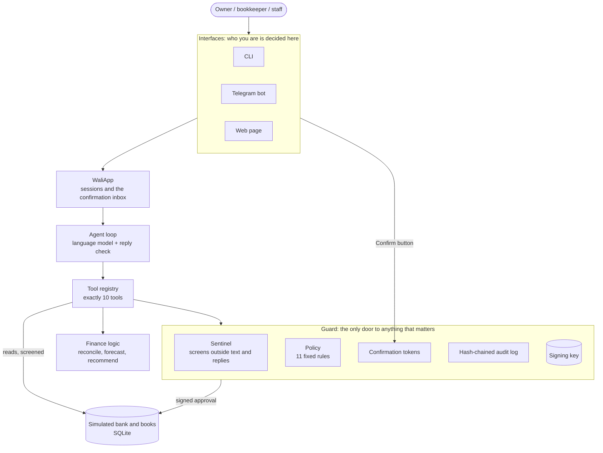

# Architecture

Wali is a finance assistant for a small business. It can reconcile the bank feed with the books,
forecast cash, suggest actions, and pay supplier invoices. **Everything runs against a simulated
business with synthetic data.**

The design rests on one rule: **the language model only proposes, plain code decides, and the
bank only accepts signed approvals.** No model output, however it was produced, can move money,
change a limit, or change someone's role.

## The parts

| Part | Code | What it does |
| --- | --- | --- |
| Interfaces | `src/wali/interfaces/` | CLI, Telegram bot, demo web page. Each decides who the person is (a role picked at the CLI or web page, a linked Telegram id) and shows Confirm and Decline buttons. Nothing typed in a chat changes who someone is |
| WaliApp | `src/wali/app.py` | Wires everything together; keeps one conversation per person and channel, and the inbox of requests waiting for confirmation |
| Agent loop | `src/wali/agent/loop.py`, `prompts.py`, `dialogue.py` | Hand-written tool-use loop (no agent framework). Calls the model, runs the tools it asks for, and checks each answer before it is shown (figures must come from the data, the language must match the person's) |
| Model clients | `src/wali/agent/llm.py`, `llm_openai.py` | Anthropic SDK, or any OpenAI-compatible endpoint, behind one small interface. Chosen in `.env` |
| Tool registry | `src/wali/tools/registry.py` | The only ten tools the model has. None takes a user, role, or account, and none can pay, confirm, or change a limit |
| Finance logic | `src/wali/finance/` | Pure functions: reconciliation in passes, a day-by-day cash forecast, recommendation candidates. The model explains results; it does not calculate them |
| Guard | `src/wali/guard/` | Holds the signing key. Decides every payment with fixed rules, issues confirmation tokens, signs approvals, screens text, and writes the audit log |
| Environment | `src/wali/tools/sim_env.py` | The simulated bank and books, with role scopes. Pays only on a valid signed approval. `organiser_env.py` is the empty slot for an organiser-provided environment |

## The ten tools

| Read | Calculate | Act (through the guard) |
| --- | --- | --- |
| `get_balance`, `list_transactions`, `list_invoices`, `get_supplier` | `reconcile_period`, `forecast_cashflow` | `record_book_entry`, `flag_for_review`, `propose_payment`, `propose_mandate` |

`propose_payment` takes an invoice id and nothing else: the amount and the account always come
from the records. `propose_mandate` only drafts; a draft takes effect when the owner confirms it.

## What happens when someone asks to pay

1. The bookkeeper types "bayarin tagihan kopi pak budi ya" in Telegram. The bot knows this
   Telegram id is the bookkeeper.
2. The message is screened. If it carries pasted text that tries to steer the assistant, every
   payment in this turn will wait for the owner.
3. The model calls `list_invoices`. Every text field read from the bank and books is screened
   first; text that looks like an injected instruction is replaced by a placeholder, so the
   model never sees it.
4. The model calls `propose_payment` with the invoice id.
5. The guard checks, in order: a valid signed mandate, the role's authority, the invoice, the
   supplier is in the mandate, **only the registered and verified account** (an account written
   on an invoice is never used), duplicate invoices, per-payment and weekly limits, the cash
   buffer, an unusual amount, the rate limit, and whether the owner must confirm. The first rule
   that fails decides.
6. Three outcomes:
   - **Refused**: the reason goes back to the model; suspicious invoices also go on the owner's
     review list.
   - **Needs the owner**: a one-time token, bound to the exact payment terms and valid for
     5 minutes, goes to the interface, never to the model. Every owner account gets Confirm and
     Decline buttons with the summary and the risk warnings.
   - **Allowed** (small and clean, within the mandate): the guard signs an approval and pays.
7. When the owner presses Confirm, the guard runs every rule again on fresh data before signing.
8. The environment checks the signature, expiry, single use, and that the destination is the
   supplier's registered account, then pays.
9. Before the reply is shown, it is checked for keys, tokens, system prompt text, full account
   numbers, and figures a staff member may not see. Every step above is in the audit log.

## Trust boundaries

| Comes from | Treated as | Enforced by |
| --- | --- | --- |
| The interface (CLI role, Telegram id, web role selector) | Who the person is | The interface; the environment also checks its own user table |
| What a person types | A request, possibly with pasted text | Screening of the message; the guard decides anything that matters |
| Invoices, memos, names, emails | Data, never instructions | The sentinel withholds instruction-like text; the policy ignores accounts written in text |
| The language model | A proposer that may be wrong or manipulated | Ten narrow tools; the guard; the reply checks |
| The guard's signing key | The only authority to pay | Held by the guard only; never in a prompt, a log, or a reply |

A test (`tests/test_attacks_smoke.py`) runs every attack against a model that has been fully
taken over: it asks to pay every invoice twice, drafts a huge mandate, records income, and tries
to show everything it saw. No payment, leak, or permission rule breaks.

## Data and state

| Where | What |
| --- | --- |
| `data/seed/` | Synthetic seed data (CSV) and `ground_truth.json` with the planted problems. Regenerated by `scripts/gen_seed_data.py` |
| `data/wali.db` | The simulated bank and books, built from the seed on first run |
| `data/guard.db` | The guard's own records: the mandate, payments it executed, review items |
| `data/audit.jsonl` | The audit log. Each entry holds the hash of the one before |
| `.env` | Settings and secrets. Never committed |

Delete the three files in `data/` to start over.

## Evaluation

`eval/` runs tasks, dialogues, attacks, and the sentinel's seed texts against the real model,
each case in its own temporary copy of the simulation. Attacks are judged only on the final
state (the ledger, the audit log, and the replies shown), never by reading what the model meant.
See the README for the command and `docs/results/` for the latest run.

## Further reading

- `docs/assumptions.md`: every decision the specification left open, and why.
- `docs/demo.md`: the demo script.
- `docs/third_party.md`: libraries and services used.
